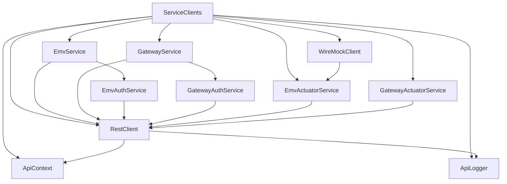

# High-Level Architecture

## 1. Overview

The EMV & Gateway integration extends PAFI with reusable components for API communication, authentication, database operations, scenario context management, and automated test configuration.

The implementation is organised under the following base package:

`com.barclaycard.systemtest.emv.gateway`

The architecture separates API communication from database access and supporting test management functionality.

A centralised `ServiceClients` class provides access to reusable API services and the shared `ApiContext`. Oracle and MongoDB integrations are managed independently.

## 2. Package Structure

The main functionality is organised into three packages:

| Package | Responsibility |
|---|---|
| `api` | REST communication, authentication, API services, endpoint definitions, request templates, and utilities |
| `db` | Oracle and MongoDB integration, database queries, entities, mapping, and token cleanup |
| `services` | Centralised service access, Scenario Context, logging, WireMock state management, and TGS configuration management |

### 2.1 API Package

The `api` package contains the following components:

| Subpackage | Main Components |
|---|---|
| `api.auth` | AuthClient, AuthService, EmvAuthService, GatewayAuthService, authentication models |
| `api.client` | RestClient, ApiRequest, ApiResponse |
| `api.config` | ApiConfig, ServiceUrls, ServiceUrlBuilder, ServiceRequests |
| `api.service` | EmvService, GatewayService, EmvActuatorService, GatewayActuatorService |
| `api.util` | ApiResponseMapper, JsonNodePatcher, JsonUtils, PasswordDecryptUtils |

### 2.2 Database Package

The `db` package separates database access by technology.

**Oracle Database**

Provides database queries, entity mapping, tokenisation data validation, and automated token cleanup.

**MongoDB**

Provides a reusable MongoDB connection and access to tokenisation configuration used by TGS validation.

### 2.3 Services Package

The `services` package contains higher-level components that coordinate framework functionality.

| Component | Responsibility |
|---|---|
| ServiceClients | Centralised access to API clients and ApiContext |
| ApiContext | Stores API exchanges and scenario-related values |
| ApiLogger | Logs HTTP requests, responses, and errors |
| DbLogger | Logs database operations |
| WireMockStateManager | Manages WireMock state changes and restoration |
| TgsConfigurationManager | Coordinates TGS configuration updates |
| TgsConfigurationValidator | Validates configuration against MongoDB |
| TgsConfigurationComparator | Compares requested and stored configuration values |

## 3. API Architecture

The API integration uses a shared REST communication layer.

`ServiceClients` initialises one `RestClient` instance, which is reused by EMV, Gateway, Actuator, and Authorization services.

This shared client is configured with:

- `ApiLogger` for HTTP request, response, and error logging.
- `ApiContext` for tracking supported API operations.

### 3.1 Service Dependencies

The following diagram represents the API client relationships.

All API services reuse the same REST communication infrastructure.

The `WireMockClient` uses `EmvActuatorService` rather than maintaining an independent REST transport.

## 4. Request and Endpoint Management

The REST integration separates HTTP execution from endpoint and request definition.

| Component | Responsibility |
|---|---|
| RestClient | Executes HTTP operations |
| ApiRequest | Contains request parameters, headers, body, and authentication information |
| ApiResponse | Represents the HTTP response |
| ServiceUrls | Defines service-specific API endpoints |
| ServiceUrlBuilder | Builds service URLs using configuration and instance information |
| ServiceRequests | Provides reusable JSON request templates |
| ApiConfig | Loads and exposes API configuration properties |

`ServiceUrls` groups endpoint definitions by service type, including EMV, Gateway, Identity, and Actuator endpoints.

`ServiceRequests` provides access to JSON templates stored under `testdata/requests/`.

This allows service implementations to use predefined endpoints and payloads rather than maintaining hardcoded request definitions.

## 5. Database Architecture

Database integration is independent of the shared `RestClient`.

### 5.1 Oracle Database

The Oracle integration provides dedicated components for:

- Database connection management.
- Query execution.
- Result mapping into Java entities.
- Token and transaction validation.
- Automated token cleanup.

Token cleanup integrates with Cucumber hooks and the existing WebPayment processing functionality.

The `@DB:cleanup_tokens` tag enables the cleanup lifecycle and initialises the required Oracle database connection without an additional `@DB` tag.

### 5.2 MongoDB

The MongoDB integration consists primarily of:

- `MongoDbClient` — connection management and pooling.
- `MongoDbService` — retrieval of stored configuration.

MongoDB is used to retrieve tokenisation settings associated with a Token Owner ID and card brand.

The TGS configuration management components use this information to compare current and requested settings and verify the result of configuration updates.

MongoDB uses its own Singleton lifecycle and is not initialised through `ServiceClients`.

## 6. Scenario Context Architecture

The `ApiContext` instance is created and exposed by `ServiceClients`.

The shared `RestClient` automatically registers completed API exchanges when Context tracking is enabled for the request.

Each recorded `ApiExchange` contains:

- The original `ApiRequest`.
- The corresponding `ApiResponse`.
- Endpoint and additional logical keys.

The Context also supports storing arbitrary typed values using `TestContextKey`.

Although the Context instance is shared through the Singleton service access layer, its stored exchanges and values are cleared after each Cucumber scenario.

Authentication requests and other technical operations can be excluded from automatic Context tracking.

## 7. Supporting Test Management Components

Several components provide additional functionality above the API and database layers.

### 7.1 WireMock State Management

`WireMockStateManager` coordinates scenario-level WireMock activation and deactivation.

It works with Cucumber hooks and the dedicated `WireMockClient` to preserve, modify, and restore the required state.

### 7.2 Automated Token Cleanup

The automated cleanup functionality combines Cucumber hooks, WebPayment response processing, `TokenCleanupStorage`, and `TokenCleanupService`.

It supports two cleanup mechanisms:

- Removing existing tokens when an eligible Token Owner ID is registered.
- Removing tokens associated with eligible transaction references after scenario execution.

The mechanism removes related records from the following Oracle tables:

- `EMV_TOKENISATION.TOKEN_ATTRIBUTES`
- `EMV_TOKENISATION.TOKENS_LOOKUP`
- `EMV_TOKENISATION.TOKEN_EVENTS`
- `EMV_TOKENISATION.TOKENS`

### 7.3 TGS Configuration Management

The TGS configuration components coordinate configuration changes through Gateway API operations and validate the resulting state against MongoDB.

The main components are:

- `TgsConfigurationManager`
- `TgsConfigurationValidator`
- `TgsConfigurationComparator`
- `TgsConfigurationScope`

Configuration updates are always submitted through the Gateway API.

The manager determines whether an activation requires additional waiting by comparing the requested configuration with its current MongoDB state.

The result is always verified against MongoDB after the update.

## 8. Component Lifecycle

Different components have different lifecycles.

| Component | Lifecycle |
|---|---|
| API Services | Lazy initialisation through ServiceClients; reused during test execution |
| RestClient | Shared instance managed by ServiceClients |
| ApiContext | Shared instance; data cleared after each scenario |
| Oracle Connection | Managed by the Oracle database integration and Cucumber lifecycle |
| MongoDbClient | Lazy Singleton; closed after the test run if initialised |
| WireMock State | Restored through an After hook |
| Token Cleanup Storage | Reset after the cleanup lifecycle |

These lifecycle boundaries allow the framework to reuse common infrastructure while automatically resetting selected scenario-related state.

## 9. Summary

The EMV & Gateway integration uses a shared REST communication infrastructure combined with independently managed database integrations.

`ServiceClients` provides the main entry point for API services and Scenario Context, while dedicated management components coordinate WireMock state, automated token cleanup, and TGS configuration validation.

The following chapters describe these components in more detail, including their public interfaces and practical usage.
